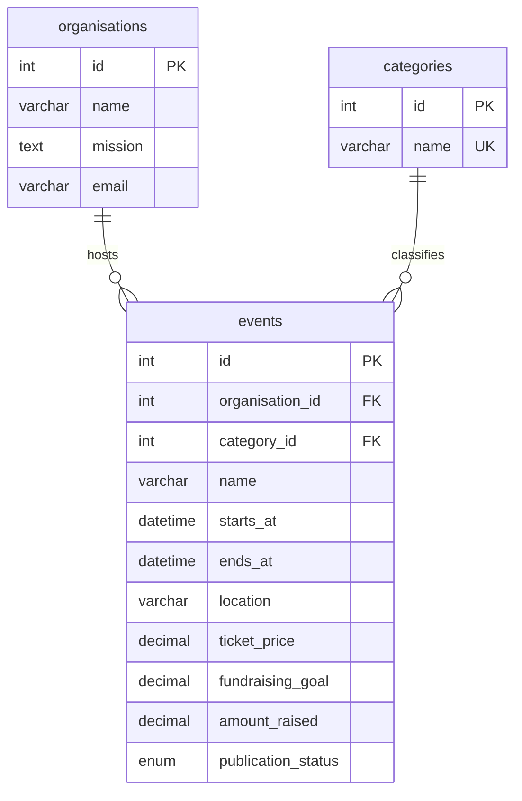

# Good Together | Charity events

PROG2002 Web Development II, Assessment 3 foundation (reuses Assessment 2)
Team: Lu Yu · 24832520; Zhuolin Han · 24832119

A3 milestone planning and actual contribution requirements are in [project/DELIVERY_PLAN.md](project/DELIVERY_PLAN.md).
The first milestone adds a registration schema and 12 fictional registrations; application registration and admin workflows are later milestones.

A charity event discovery website for the Gold Coast, built with Node.js, Express,
MySQL and plain HTML, CSS and JavaScript. All organisations, events, contact details
and fundraising figures in the sample dataset are fictional.

## Run locally

Requires Node.js 20+ and MySQL 5.7+. Extract both source archives into the same
folder, so `api` and `clientside` are siblings.

1. Import the SQL file into a **fresh database**:

   ```sh
   mysql -h 127.0.0.1 -u root -p -e "CREATE DATABASE charityevents_a3 CHARACTER SET utf8mb4 COLLATE utf8mb4_unicode_ci"
   mysql -h 127.0.0.1 -u root -p charityevents_a3 < api/database/charityevents_db.sql
   ```

   The SQL creates tables and sample data in the selected database. It does not create, select or drop a database, making it suitable for cPanel imports. It does not drop
   existing tables. Import it once; importing a second time deliberately fails
   instead of erasing data. On the supplied Mac, the MySQL executable is
   `/Applications/phpstudy/Extensions/MySQL5.7.28/bin/mysql`.

2. Set the local connection details:

   ```sh
   cp api/.env.example api/.env
   ```

   Edit `api/.env`. The real password must stay in this ignored local file.

3. Install, check and start:

   ```sh
   cd api
   npm ci
   npm run db:check
   npm start
   ```

4. Open **http://127.0.0.1:3090**. The same Express server serves the client and API.
   Do not open the HTML files with `file://`. Change `PORT` in `.env` if needed.

If MySQL is unavailable, start it before the Node server. If the schema already
exists, keep it; use a separately named database for a fresh experiment rather
than deleting existing data. Production deployment is outside this local demo.

## Features

- Home page with the organisation's mission, contact details, API-loaded category
  links and all current/upcoming active events.
- Search by event start date, partial suburb name and category, individually or
  together. Clear Filters resets the controls and results. Filters survive reload
  and browser Back through the URL.
- Event details with purpose, description, local times, venue, accessibility,
  ticket pricing, quantity preview and fundraising progress.
- Register opens: **This feature is currently under construction.** No personal
  information is collected, booking created or payment taken.
- Loading, empty, validation and server-error states, plus retry controls.
- Responsive layouts, labelled inputs, keyboard focus, a skip link and a native
  modal with explicit focus restoration.

## Structure

```text
api/
  database/charityevents_db.sql   schema, triggers and 12 sample events
  event_db.js                    MySQL promise connection pool
  app.js                         Express routes, queries and error handling
  validation.js                  date, ID and filter validation
  server.js                      startup and graceful shutdown
  scripts/check-db.js             repeatable connection and sample-data check
  test/api.test.js               isolated database/API tests
  requests.http                  manual API examples
clientside/
  index.html                     Home
  search.html                    Search
  event.html                     Event details
  404.html                       missing-page recovery
  css/styles.css                 responsive layout and visual styles
  js/common.js                   fetch, dates, amounts and DOM rendering
  js/home.js                     Home API requests
  js/search.js                   filters, history and cancellation
  js/event.js                    selected event, quantity and dialog
  assets/                        locally served imagery and credits
tests/browser_test.py            browser acceptance checks
report/                         technical PDF, source, figures and test evidence
```

## Data model



There are 2 organisations, 6 categories and 12 events. When imported, the dataset
contains 10 public current/upcoming events, 1 past event and 1 suspended event.
Dates are relative to the import date, then remain fixed. Over time, more events
will naturally become past. The current all-day sample ends on the import day.

All stored date-times use **Australia/Brisbane (UTC+10)**. Queries compare them to
`UTC_TIMESTAMP() + INTERVAL 10 HOUR`, independent of the server's default time zone.
The browser also formats dates in Brisbane time.

Publication status controls visibility. Current/upcoming/past is calculated from
start/end times rather than stored. A past detail link remains available but cannot
register; a suspended detail link returns 404. Raised amounts may exceed the goal,
while the visual progress bar is capped at 100%. Prices are DECIMAL, with 0 for free.
MySQL 5.7-compatible triggers validate date order and monetary values on both
INSERT and UPDATE. Foreign keys prevent orphaned event records.

## API

| Method | Endpoint | Behaviour |
| --- | --- | --- |
| GET | `/api/events` | All current/upcoming active events, ordered by start time then ID |
| GET | `/api/events?date=YYYY-MM-DD&location=Southport&category=1` | Optional AND filters: exact start date, literal partial suburb, category ID |
| GET | `/api/categories` | All category IDs, names and descriptions |
| GET | `/api/events/1` | Full details for one public event |
| GET | `/api/health` | Database connectivity check |

GET requests have no request body. Collections use `{ data: [...] }`; event lists
also include `meta.count`, `meta.filters` and `meta.timeZone`. Details use
`{ data: {...}, meta: { timeZone: 'Australia/Brisbane' } }`.

Invalid date/ID/filter: **400**. Missing/suspended event: **404**. Unsupported write
method: **405**. Unexpected database error: **503**, with a generic public message.
No matches is **200** with an empty array. Prepared statements bind values
separately from SQL. Location wildcard characters are escaped. API responses use
`Cache-Control: no-store`, and returned text is rendered with `textContent`.

## Verification

```sh
cd api
npm test
```

The 32 backend tests create a uniquely named temporary database, import the schema,
then remove that database after the suite. The database user therefore needs
CREATE/DROP privileges for tests. Tests do not change `charityevents_db`. The suite
uses the same MySQL engine as the application, including foreign keys and triggers.

For browser checks, start the app, then from the project root:

```sh
python3 -m pip install -r tests/requirements.txt
python3 -m playwright install chromium webkit
python3 tests/browser_test.py
```

The browser suite covers the visitor journey, combined filters, clearing, history,
empty results, error recovery, detail errors, free/past events, dialog behaviour,
and 390/768/1440 px layouts. It changes no database data. `BASE_URL` may override
the default address. Screenshots and JSON results go to ignored `tmp/qa`.
The checks expect the supplied sample dataset, including an upcoming event with
ID 1. If those events have all ended, use a fresh, separately named test database
and point a separate app instance at it; do not overwrite existing demonstration
data just to run tests.

Validation on 17 September 2026: **32 backend tests and 32 browser checks passed**
using Node 20.20.0, MySQL 5.7.28, Chromium and WebKit. `npm audit` reported no known
vulnerabilities for the installed dependency tree at that time.

Final verification on 21 September 2026: **32 backend tests and 32 browser checks
passed**. Home and clear-filter checks use the API's current event count, since
sample events naturally become past after import. The final logs and screenshots
are included under `report/verification/` and `report/figures/`.

## Project status

The project is organised into **four** milestones on separate development days:

- 17 September, `311e2d0` - Set up charity event database and Node.js connection.
- 18 September, `2baba9c` - Add read-only event APIs with search filters and validation.
- 19 September, `ec959a8` - Build responsive event discovery and registration preview pages.
- 21 September, this milestone - Document setup and verify browser workflows.

The fourth milestone includes this README, the browser checks and the technical
report with updated evidence. Commit dates reflect when the changes were actually
committed.

The A2 repository is https://github.com/364962/prog2002-a2-charity-events.
The A3 repository is https://github.com/364962/prog2002-a3-charity-events.
Source documents, local credentials, generated media and temporary files are
excluded from commits. Before assessment submission, grant the marker access.
Registration, payments and admin features
remain outside Assessment 2.

## References and assets

- [Express error handling](https://expressjs.com/en/guide/error-handling/)
- [MySQL2 documentation](https://sidorares.github.io/node-mysql2/docs)
- [Image credits](clientside/assets/CREDITS.md)

The technical report contains the preparation disclosure relevant to the supplied
assessment's GenAI restrictions. Review those conditions before using this material
in an assessment submission.
