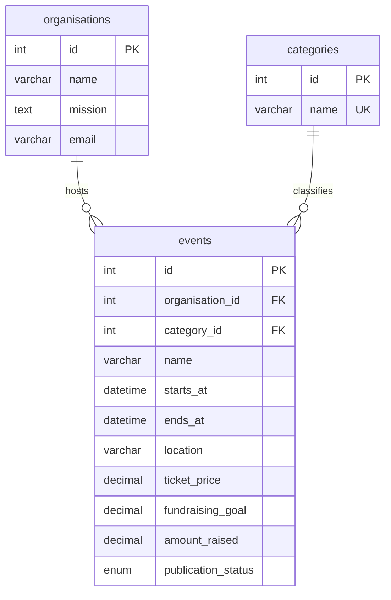

# Good Together | Charity events

PROG2002 Web Development II, Assessment 2  
Student: 鲁彧 (Lu Yu) · 24832520

A charity event discovery website for the Gold Coast. The project uses Node.js,
Express, MySQL and plain HTML, CSS and JavaScript. All organisations, events and
fundraising figures in the sample dataset are fictional.

## First milestone: database foundation

- MySQL schema with organisations, categories and events.
- Twelve sample events, including free, current, upcoming, past and suspended events.
- Foreign keys, indexes and validation triggers compatible with MySQL 5.7.
- Node.js connection pool in `api/event_db.js` and a connection check.

## Set up

Requires Node.js 20 or later and MySQL 5.7 or later.

1. Import `api/database/charityevents_db.sql` into a fresh database:

   ```sh
   mysql -h 127.0.0.1 -u root -p < api/database/charityevents_db.sql
   ```

2. Copy `api/.env.example` to `api/.env` and enter your local database password.
3. Install and check the connection:

   ```sh
   cd api
   npm ci
   npm run db:check
   ```

The SQL file creates `charityevents_db`. It deliberately does not drop existing
tables. Import it once into a fresh database. Event dates are relative to the
import date so the demonstration includes upcoming events when installed later.
All event times use Australia/Brisbane (UTC+10), which has no daylight saving.

## Data model



Publication status controls visibility; past/current/upcoming is calculated from
dates rather than stored, so it cannot become stale. Prices use fixed-point
DECIMAL values. Free events have a zero ticket price. MySQL 5.7 does not enforce
CHECK constraints, so insert and update triggers validate date order and amounts.

## Remaining milestones

1. Read-only event and category APIs, combined filters and validation.
2. Responsive Home, Search and Details pages, using fetch and DOM updates.
3. End-to-end checks, project report, demonstration video and submission archives.

Registration and payments belong to Assessment 3. Assessment 2 will display the
specified under-construction message when Register is selected.
